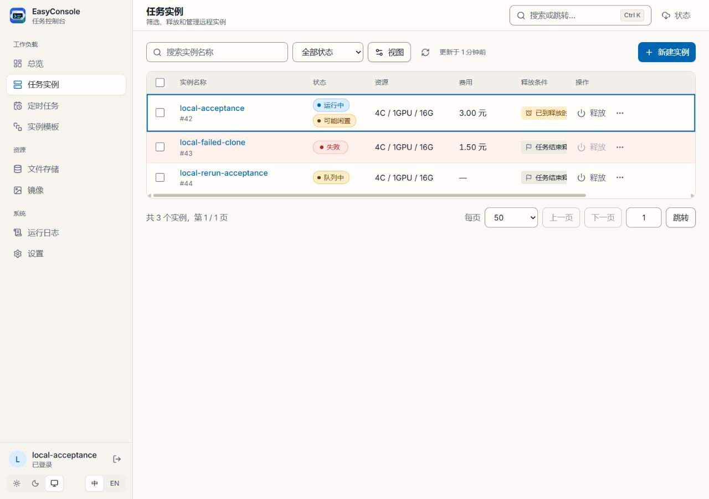
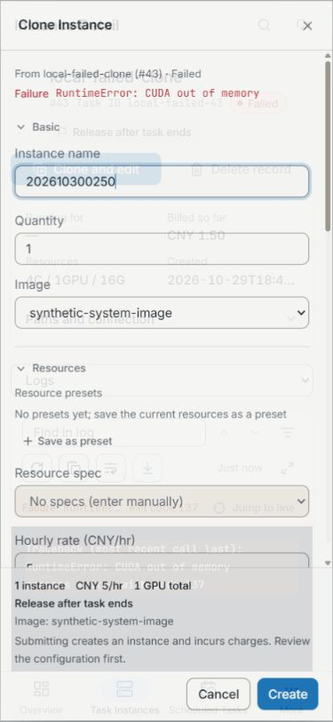

# 2026-10-30 前端回归与本地界面验收

状态：**本地回归通过；模拟界面验收通过；Windows 原生窗口仅验证启动。** 产品仍为 0.4.27，未发布候选版本。前端源码提交为 `1fcc2a65862eacc33152052e2bcb9df4d7f6554d`；验收工具、截图及本记录另作主题提交，远程结果见 [PR #30 的检查页](https://github.com/Chr0nixz/EasyConsole/pull/30/checks)。

## 范围与修复

本轮覆盖实例费用和释放倒计时、持续显示的“可能闲置”标记、失败实例克隆时的日志诊断、筛选空状态及“实例 / Instance”用语。保留原有表格密度和内部横向滚动。

回归中补齐以下边界：

- 实例停止运行后，立即隐藏闲置标记，不等待下一次监控采样。
- 监控请求失败后，清除上一次的闲置证据及 GPU 采样历史；关闭检测同样清除标记。前两项用例先复现失败，修复后通过。
- 单实例创建按钮关联费用说明；定时释放的金额写为按所填单价估算，并说明实际费用可能不同，避免把估算写成保证的上限。

## 自动化检查

以下检查均基于本轮最终功能与验收工具源码完成。

| 检查 | 结果 |
| --- | --- |
| `npm.cmd run typecheck` / `typecheck:tools` | 通过 |
| `npm.cmd run lint` | 通过，37 warnings / 0 errors；未提高 ratchet |
| 验收工具定向 ESLint | 通过 |
| `npm.cmd run test` | 120 个文件，896 项测试全部通过 |
| `npm.cmd run test:coverage` | 同一批 896 项通过，四项覆盖率门槛通过 |
| `npm.cmd run build:desktop` | 通过，包含两份 sidecar 与 Vite 桌面输入构建 |
| `cargo check --manifest-path src-tauri/Cargo.toml` | 通过 |
| `cargo fmt --manifest-path src-tauri/Cargo.toml --all -- --check` | 通过 |
| `cargo clippy --manifest-path src-tauri/Cargo.toml --all-targets -- -D warnings` | 通过 |
| 重建后的打包 CLI 备份兼容冒烟 | 通过 |
| `git diff --check` | 通过 |
| 变更 UI 的界面模式检查器 | 未报告问题；不等于完整无障碍审计 |

| 覆盖率 | 已覆盖 / 总数 | 比例 |
| --- | --- | --- |
| Lines | 7903 / 12004 | 65.83% |
| Statements | 8842 / 13957 | 63.35% |
| Functions | 2196 / 3912 | 56.13% |
| Branches | 6262 / 10966 | 57.10% |

## 实际渲染检查

Windows 启动使用已有的独立验收配置 `tools/acceptance/tauri.conf.json`（`com.easyconsole.acceptance`），确认原生窗口能够打开。随后原生自动输入受到当前桌面用户输入干扰，因此本轮没有继续原生交互验收。下表交互由本地浏览器渲染器完成，不能据此认定 WebView、安装包或 Android 真机行为通过。

渲染器为 `http://127.0.0.1:1439`，经同源代理访问 `http://127.0.0.1:28991/api` 的模拟服务。登录名、口令、实例和日志均为合成数据；本轮没有使用真实控制台账号或提交真实实例操作。

| 场景 | 观察结果 |
| --- | --- |
| 中文桌面 1280 × 900 | 列表显示已计费、释放条件、闲置标记；操作列可用，无页面横向溢出 |
| 1024px 桌面及暗色主题 | 表格在区域内横向滚动；新建表单与页脚可见，主题切换正常 |
| 仪表盘 | 合成运行实例显示约 12 CNY/小时，失败状态与释放倒计时可读 |
| 失败实例详情与克隆 | 日志提取 `RuntimeError: CUDA out of memory` 和退出码 137；克隆表单显示来源与失败原因 |
| 英文 375 × 812 | 克隆表单、来源、失败原因及提交页脚可见；根元素宽度与视口均为 375px |
| 键盘焦点 | 克隆对话框首尾 Tab / Shift+Tab 循环；创建按钮通过 `aria-describedby` 关联费用说明 |
| 创建与取消 | 取消克隆未提交；创建一份合成克隆后出现排队实例和成功提示 |
| 无匹配状态 | 显示“没有该状态的实例 / No instances in this status”；清除状态筛选后恢复列表 |
| 释放确认 | 显示停止计费及容器数据销毁说明；点击取消，模拟 API 未收到释放请求 |
| 命令面板 | Ctrl+K 显示“新建实例”，选择后打开新建表单 |

本次模拟服务审计只记录一条创建请求，实例 42 仍为运行中；没有实例 PUT / PATCH / DELETE 请求。见 [审计快照](docs/release-evidence/2026-10-30/frontend-mock-audit.json)。这是模拟服务的请求记录，不是整机网络审计。

### 原始界面截图

中文桌面列表：



英文窄屏克隆表单：



## 复查入口

在两个终端分别启动；两者均只监听 loopback：

```powershell
node --import tsx tools/acceptance/mock-console.ts
node --import tsx tools/acceptance/browser-renderer.ts
```

打开 `http://127.0.0.1:1439`，模拟登录使用 `local-acceptance` / `synthetic-only`。默认提供实例 42；`POST /__acceptance/tasks` 接受 `{ "items": [...] }`，可在独立验收会话中加入失败实例 43（`task_id: "local-failed-43"`、`status: 7`）以查看 OOM 合成日志。`GET /__acceptance/state` 可检查模拟请求和实例状态。对应列表、创建与释放状态一致性由 `tools/acceptance/new-features.test.ts` 覆盖。

本轮结束后已关闭任务创建的浏览器页及本地验收进程。

## 尚未覆盖的发布门槛

本轮没有完成真实后端接口和计费语义、完整 Windows 原生交互、安装及 0.4.27 升级迁移、系统钥匙串、OpenSSH / GPU、计划唤醒、Android 真机、其他桌面平台安装或团队试用。此前 `91c5153` 的签名出包演练只证明当时源码的产物，不视为本轮 UI 的新安装包验收。相关发布清单项目继续保留待办。
